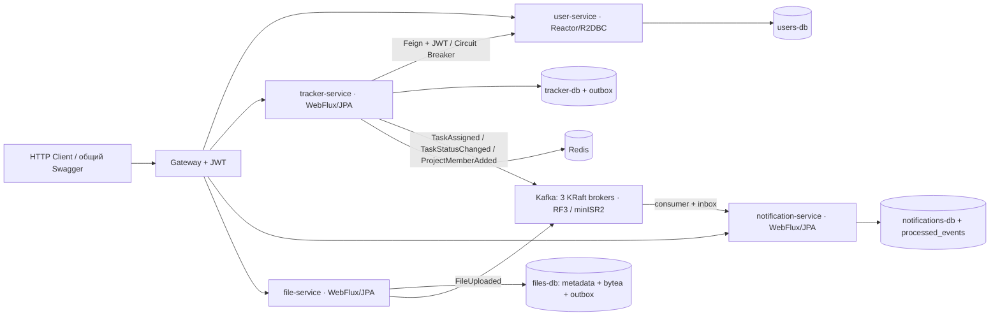
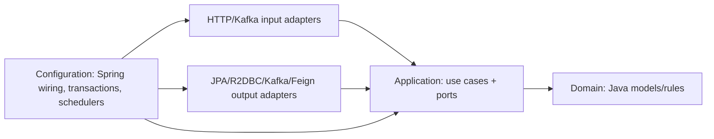

# ЛР4: итоговая реализация и приемка

Система после ЛР3 дополнена Kafka, уведомлениями и файловым сервисом; четыре бизнес-сервиса приведены к Clean Architecture. Все восемь этапов завершены; материалы итоговой приемки включены в main после feature/lab4-acceptance. Текущее состояние и история проверок — в [плане](../IMPLEMENTATION_PLAN_LAB4.md). Результаты ЛР3 в [предыдущем handoff](LAB3_HANDOFF.md) являются историческими.

## Быстрый запуск и приемка

Для своего учебного стенда скопировать .env.example в .env, задать пароли БД и при первом старте включить bootstrap ADMIN с собственными email/password. По умолчанию bootstrap выключен. После создания ADMIN его можно снова выключить; ключ и БД сохраняются.

```bash
./scripts/docker-up.sh
```

Общий Swagger по умолчанию: http://localhost:8081/swagger-ui/index.html. Порты/каталог ключей/таймаут берутся из Compose и env-файла, фактический URL печатает startup. Приватный RSA-ключ нужен только user-service, публичный — Gateway и бизнес-сервисам. [Подробности запуска и конфигурации](LAB4_INTEGRATION.md).

Полная автоматическая приемка, с JDK 21, Maven, Docker Compose, Bash, curl, OpenSSL и Python 3:

```bash
./scripts/lab4-acceptance.sh
```

Команда выполняет последовательно:

1. mvn clean verify: JUnit Jupiter, PostgreSQL/Redis/Kafka Testcontainers, ArchUnit, JaCoCo.
2. scripts/notifications-smoke.py: полный новый Compose-проект через реальный startup, затем API/JWT/Feign/события/файлы/отказы.
3. scripts/kafka-smoke.sh: отдельный трехброкерный проект, описание топиков, отказ лидера, восстановление ISR и сохранность на volumes.

При ошибке команда завершается ненулевым кодом; путь логов печатается всегда. После успешных трех фаз создается summary.json: число тестов/ошибок/пропусков, покрытие каждого инструментированного модуля и взвешенное покрытие строк. Общие логи лежат в отдельном временном каталоге lab4-acceptance.*, детальные Docker-логи — по путям из integration.log/kafka.log. Пропущенные тесты не принимаются как PASS.

Тесты используют собственные project names, БД/volumes и RSA-ключи. Полный стенд публикует только случайные localhost-порты Gateway и UI; остальные host-порты сбрасываются. Smoke удаляют только свои ресурсы в finally/trap. Для своей рабочей установки команда down --volumes не выполняется. Последовательность фаз уменьшает одновременную нагрузку.

## Соответствие ЛР4

| Требование | Реализация | Подтверждение |
|---|---|---|
| Межсервисное взаимодействие через брокер, где возможно | tracker/file → outbox → Kafka → notification. Синхронный Feign оставлен для проверки пользователя/роли перед локальной записью | [JpaTrackerEvents](../tracker-service/src/main/java/itmo/tracker/adapter/out/persistence/JpaTrackerEvents.java), [JpaFileEvents](../file-service/src/main/java/itmo/files/adapter/out/persistence/JpaFileEvents.java), [UserDirectory](../tracker-service/src/main/java/itmo/tracker/adapter/out/user/UserDirectory.java) |
| Уведомления через Kafka | TaskAssigned, TaskStatusChanged, ProjectMemberAdded, FileUploaded; хранение, свои страницы и PATCH read | [NotificationService](../notification-service/src/main/java/itmo/notification/application/NotificationService.java), [правила событий/API](LAB4_NOTIFICATIONS.md), NotificationIT и полный smoke |
| Минимум три брокера, несколько топиков, репликация | Три KRaft узла, 3 основных топика + 3 DLT, по 3 partitions/RF=3/minISR=2; acks=all, idempotence. Внутренние offset/transaction-топики тоже RF=3 | [Compose](../docker-compose.yml), [init и проверка топиков](../infra/kafka/init-topics.sh), [Kafka smoke](../scripts/kafka-smoke.sh) |
| Отдельный сервис загрузки/получения файлов | file-service: multipart POST, GET metadata/content; bytea отдельно от метаданных, собственная PostgreSQL и volume, 10 MiB по умолчанию | [FileController](../file-service/src/main/java/itmo/files/adapter/in/web/FileController.java), [FileService](../file-service/src/main/java/itmo/files/application/FileService.java), [FileIT](../file-service/src/test/java/itmo/files/FileIT.java), [описание файлов](LAB4_FILES.md) |
| Clean Architecture во всех микросервисах | У user/tracker/notification/file независимые domain/application, собственные порты и внешние адаптеры. JPA/R2DBC/HTTP/Kafka/Security остаются снаружи. Gateway/Config/Eureka — инфраструктура без предметных сценариев | ArchitectureTest в каждом бизнес-модуле; [структура слоев](../IMPLEMENTATION_PLAN_LAB4.md#7-clean-architecture) |

Feign не заменен отстающей Kafka-проекцией: проверка существования пользователей/роли тимлида должна дать ответ до создания проекта/назначения. Уведомление не обязано синхронно завершаться с пользовательским HTTP-запросом, поэтому передано в Kafka. Распределенной транзакции между БД и Kafka нет.

## Сохранение ЛР1–3

| Требование | Текущее состояние и проверка |
|---|---|
| Java/Kotlin, Spring Boot, стабильные версии, сборка | Java 21, Maven, Boot 3.5.6/Cloud 2025.0.3; версии закреплены в [pom](../pom.xml); Dockerfile собирает каждый сервис |
| Осмысленный REST CRUD основных сущностей, HTTP-статусы | Users, projects, tasks, labels, project members. UserIT/ProjectIT/TaskIT/LabelIT/PermissionsIT проверяют CRUD и 201/204/400/401/403/404/409/503. Новые file/notification API ограничены назначением ЛР4 |
| Spring Data и отделение Entity/DTO | User — R2DBC; tracker/notification/file — JPA. Entity находятся в adapter/out/persistence, REST DTO — adapter/in/web; внутренние модели отдельные |
| Валидация на HTTP и Entity | Bean Validation, bounded pagination/multipart, JPA entity constraints; R2DBC UserBeforeConvertCallback; соответствующие unit/IT |
| Миграции/отдельные БД/конфигурация окружением | Liquibase в четырех бизнес-сервисах, четыре PostgreSQL и volumes, Config Server + environment, собственный outbox у producer-сервисов |
| Каждый публичный список ≤50 | Валидация page/size; unit/IT. Через Gateway дополнительно проверяются users/tasks/labels/notifications с size=51 →400 |
| Страница с общим количеством | X-Total-Count у списков; полная приемка проверяет tasks и notifications |
| Бесконечная прокрутка без количества | GET /api/v1/tasks/feed?limit=1, X-Next-Cursor и afterId; без X-Total-Count. TaskIT.shouldReadTaskFeedByCursorWithoutCountQuery проверяет также отсутствие SQL count |
| Не менее двух сложных транзакций | ProjectServiceImpl.create — проект+членство; TaskServiceImpl.move — проект/исполнитель/метки. Причины и проверки ниже |
| Связи всех типов | Project–Task OneToMany/ManyToOne; Task–Label ManyToMany; Project–User через project_members с joined_at/active. User хранится в другой БД: user_id — внешний ID, проверяется через Feign, межбазового FK нет |
| Enum как строки | JPA EnumType.STRING, роль пользователя — строка; миграции и IT сохраняют это поведение |
| Читаемые ошибки | ApiError/единый JSON timestamp/status/error/message/path/fieldErrors; SQL/пароль в ответе ошибки не раскрывается |
| Чистые слои, SOLID/DRY/KISS | Независимые сценарии, порты/адаптеры, небольшие DTO и библиотеки; направления зависимостей защищены ArchUnit. Оценка читаемости остается ревью кода |
| Общий OpenAPI 3/Swagger | Один UI Gateway, четыре схемы с bearerAuth и относительным server /; startup и smoke проверяют UI/selector/схемы |
| Docker/Compose | Весь стенд, включая БД/брокеры/UI, запускается startup без ручной подготовки ключей; чистый и повторный запуск проверяются smoke |
| Feature branching/conventional commits | Отдельные feature/lab4-* ветки и Conventional Commits, последовательные слияния в main |
| Unit/integration, JUnit/Testcontainers, ≥70% | Полный clean verify, реальные PostgreSQL/Redis/Kafka, gates по семи модулям с отчетами; config-server/discovery-server не включены в JaCoCo |
| Eureka/Config/Gateway | Шесть активных регистраций (Config, Gateway, четыре business), пять клиентов Config Server; lb:// маршруты и четыре схемы проверены через полный startup |
| Feign/Circuit Breaker | JWT через worker и Feign; UserCircuitBreakerIT: CLOSED/OPEN/HALF_OPEN, таймауты, 401/403 вне статистики доступности. TaskIT — отказ user-service не создает задачу |
| Reactor + R2DBC | user-service Mono/Flux и реактивные порты/репозитории |
| Reactor + JPA/JDBC | tracker WebFlux + JPA/Feign/Redis на ограниченном worker; BlockingBoundaryIT проверяет границу потоков/транзакций. Новые сервисы также WebFlux/JPA |
| Spring Security + JWT Authorization | RS256, issuer/audience/claims, независимая проверка Gateway/backend; security-common/Gateway/User/Permissions/File/Notification тесты |
| Роли и логика текущего пользователя | ADMIN управляет пользователями; TEAM_LEAD управляет своим проектом; активный DEVELOPER меняет статус назначенной ему задачи; authorId/ownerId/recipientId берутся из JWT |
| Пароли не попадают в пользовательские ответы | UserResponse/UserReference, UserIT.shouldHashPasswordAndNeverReturnCredentials; полная приемка проверяет DTO и payload outbox на секретные поля |
| Пароли хэшированы, создание только супервайзером | BCrypt; ADMIN-only маршруты и ManagedUserService; bootstrap включается явно, повторный startup с bootstrap=false сохраняет созданного ADMIN |

Согласование архитектуры БД с преподавателем — организационный пункт ранее сданных ЛР1–3; технические проверки его не подтверждают. Новые таблицы/границы БД описаны здесь и в миграциях для обсуждения на защите.

### Почему нужны транзакции

1. ProjectServiceImpl.create: проект и автоматическое членство тимлида должны появиться вместе. Ошибка вставки членства/outbox откатывает проект. ProjectIT и PermissionsIT проверяют rollback.
2. TaskServiceImpl.move: новый проект, исполнитель и метки сохраняются вместе; нельзя оставить задачу частично перенесенной при ошибке членства или optimistic version. TaskIT/PermissionsIT проверяют это поведение.
3. FileService.upload: метаданные, bytea и FileUploaded outbox — одна локальная запись. FileIT принудительно ломает outbox и подтверждает отсутствие всех трех записей.
4. NotificationService.receive: processed_events и все уведомления eventId коммитятся вместе. Ошибка уведомления откатывает маркер; повтор безопасен. Kafka offset подтверждается после успешного сценария; при DLT — только после ack DLT.

Проверки внешнего user-service выполняются до локальных транзакций tracker. Сетевое ожидание Kafka ack вынесено из пользовательской транзакции в publisher.

## Схема взаимодействия



Eureka предоставляет discovery; Config Server — общую/сервисную конфигурацию. Gateway не определяет предметные права владельца файла или уведомления: это делают backend-сценарии.



## Ручная демонстрация

[requests/lab4.http](../requests/lab4.http) — файл IntelliJ IDEA HTTP Client; [sample.txt](../requests/sample.txt) — маленький файл для загрузки. Это ручной сценарий для последовательной демонстрации. Скопировать [шаблон private env](../requests/http-client.private.env.json.example) в requests/http-client.private.env.json и задать свои adminEmail/adminPassword; private env исключен из Git. В IDEA выбрать Run with: lab4. Адрес и учебный пароль новых аккаунтов заданы в [public env](../requests/http-client.env.json), baseUrl можно изменить. Первый login создает новый уникальный runId; ID и токены извлекаются из ответов, номера строк БД не зашиты.

Выполнять по одному запросу сверху вниз на учебном стенде. Пользователи/проект/задачи создаются с уникальным суффиксом; исходный ADMIN не меняется. Демонстрационные аккаунты имеют учебный demoPassword из public env; реквизиты ADMIN находятся в локальном private env. Локальные HTTP Client responses и private env исключены из Git. Уведомления асинхронны: если запрос 21 еще пуст, повторить его через 1–2 секунды перед PATCH read. При истечении JWT повторить login соответствующей роли; запрос 37 обновляет ADMIN token без нового runId.

Последовательность показывает:

- только ADMIN создает пользователей, пароль отсутствует в ответе;
- ProjectMemberAdded при создании проекта/добавлении/реактивации участника;
- TaskAssigned исполнителю, TaskStatusChanged автору, запреты 403 и stale version 409;
- X-Total-Count у страницы и cursor feed без count;
- чужое уведомление недоступно даже ADMIN (404), read владельцем идемпотентен (204);
- multipart файл, метаданные/скачивание владельцем и ADMIN, чужой файл 403, без JWT 401, отсутствующий 404, пустой 400, FileUploaded;
- действующий JWT не обходит проверку деактивированного членства.

Большой/chunked файл и отказ брокера демонстрируются автоматическим smoke, чтобы не хранить большие binary в репозитории. Для ручной проверки репликации на своем отдельном тестовом проекте:

```bash
docker compose -p YOUR_TEST_PROJECT exec kafka-1 /opt/kafka/bin/kafka-topics.sh --bootstrap-server kafka-1:9092 --describe
```

Интеграционный smoke использует отдельный project name и сам выбирает фактического лидера task partition по изменению offsets, останавливает только этот брокер своего проекта, подтверждает уведомление при ISR=2 и затем возврат ISR=3. Файлы assignment-topics-before-leader-stop.txt / with-one-broker-down / after-leader-return.txt сохраняют описание в Docker log directory. Отдельный Kafka smoke проверяет все шесть топиков, идемпотентный init, внутренний offset topic и чтение после пересоздания трех брокеров на прежних volumes.

[Синтаксис HTTP Client и response handlers](https://www.jetbrains.com/help/idea/exploring-http-syntax.html), [global variables](https://www.jetbrains.com/help/idea/http-client-reference.html).

## Гарантии и границы

- Уведомление доставлено после записи в БД; прочитано только после PATCH read. Внешние email/Telegram/WebSocket не требовались.
- Между БД и Kafka — at-least-once. Повторный eventId не дает второго уведомления. Exactly-once между разными БД/Kafka не заявляется.
- Bounded retry consumer: первоначальная попытка +2 повтора, затем source-topic.dlt в ту же партицию. Сбой отправки DLT не продвигает исходный offset; NotificationIT проверяет это на Kafka с контролируемым отказом публикации. DLT не replay-ится автоматически; после исправления причины нужен контролируемый повтор с прежним eventId.
- По одному publisher-процессу на producer-сервис; lease/claim для горизонтального масштабирования не реализован. Batch останавливается на ранней ошибке; опубликованные записи старше 7 дней чистятся, pending и inbox-маркеры сохраняются.
- Файлы в PostgreSQL bytea для ограниченного учебного объема; по умолчанию 10 MiB, максимум конфигурации 50 MiB, body buffering не является общим лимитом памяти всех параллельных запросов. Список/удаление/связь файлов с задачами не требовались.
- Автотест Kafka RF=1 подтверждает consumer/inbox/DLT, но не репликацию. RF=3/ISR и отказ реального лидера подтверждаются отдельными Docker-проверками.
- UI проверены по HTTP и конфигурации; визуальное прохождение Swagger Authorize/pgAdmin не заявляется. .http — подготовленный ручной сценарий; API-контракты проверяет автоматическая приемка, запуск именно из IntelliJ здесь не выполнялся.

## Фактические результаты

Полная команда `scripts/lab4-acceptance.sh` завершилась **PASS, exit 0**, 06.11.2026 (MSK), JDK 21.0.10. Завершение отчета: 2026-11-05T23:45:34 UTC.

| Модуль | Тестов | Покрытие строк |
|---|---:|---:|
| security-common | 2 | 94,87% |
| event-contracts | 5 | 100% |
| user-service | 55 | 96,69% |
| tracker-service | 172 | 94,78% |
| api-gateway | 4 | 92,42% |
| notification-service | 12 | 96,76% |
| file-service | 15 | 92,56% |
| Всего | **265** | **95,01% взвешенно** |

Ошибок, падений и пропусков — 0; все настроенные gates ≥70% пройдены. Config Server и Eureka не имеют тестов/JaCoCo gate; их запуск/регистрация проверены общим Compose smoke и не включены в расчет покрытия.

Полный интеграционный smoke — PASS: startup дважды, env/ключи/bootstrap=false, UI/selector/четыре схемы, Eureka/Config, JWT/Feign, четыре типа событий, consumer restart, полный простой Kafka/DLT, файл 10 MiB chunked и сохранность после пересоздания БД/сервиса. Новый сценарий остановил kafka-2 — фактического лидера task partition 0 — и подтвердил уведомление при ISR=2, затем ISR=3. Пагинация/total/cursor и отсутствие credential/binary полей в DTO/outbox также прошли.

Отдельный Kafka smoke — PASS: шесть топиков и повторный init, RF=3/ISR=3, запись/чтение с одним выключенным лидером, возврат ISR=3, все сообщения сохранены после пересоздания трех брокеров на прежних volumes. Тестовые проекты, volumes, ключи и локальные образы удалены.

37 HTTP-запросов, 19 JSON-тел, переменные env и синтаксис 31 JavaScript handler проверены статически. Запуск этих запросов именно из IntelliJ не выполнялся; автоматическая приемка проверяет соответствующие API-контракты. Ссылки документов, Bash/Python syntax и git diff --check — без ошибок.

При воспроизведении новая команда создает собственный summary.json и логи; результаты выше относятся к зафиксированному прогону этапа 8.
